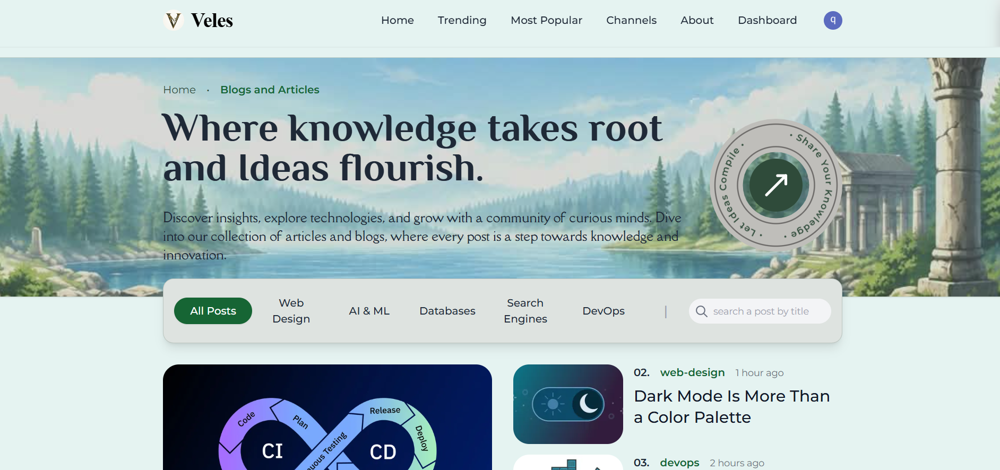
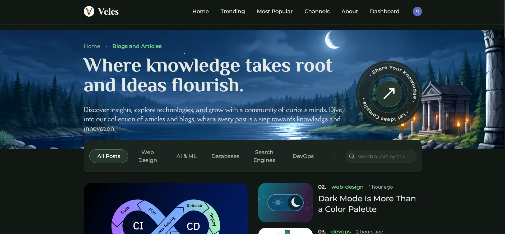
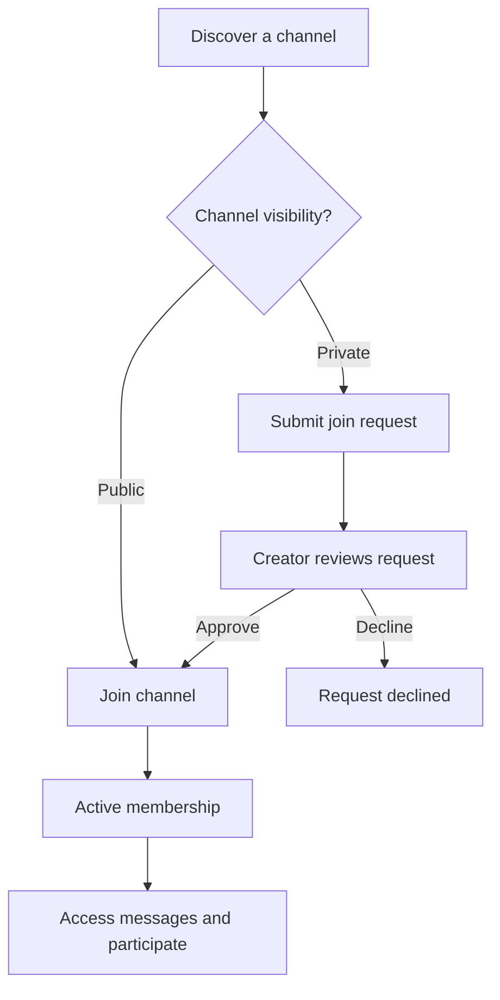
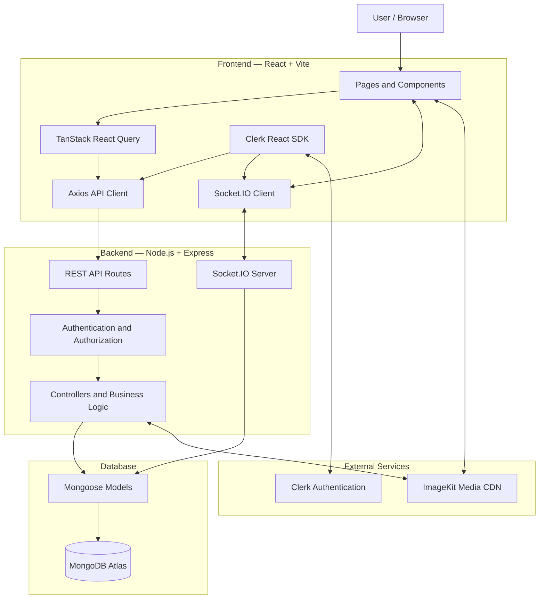

# VELES

### A Technical Publishing & Real-Time Community Platform

**Write. Share. Discuss. Build knowledge together.**

[](https://veles-phi.vercel.app/)
[](https://react.dev/)
[](https://nodejs.org/)
[](https://www.mongodb.com/atlas)

Veles brings technical articles, author profiles, community channels,
and real-time conversations together in one platform for developers,
engineering students, and technology enthusiasts.
:::

------------------------------------------------------------------------

## Table of Contents

-   [Overview](#overview)
-   [Screenshots](#screenshots)
-   [Features](#features)
-   [Community Channels and
    Messaging](#community-channels-and-messaging)
-   [Technology Stack](#technology-stack)
-   [Architecture](#architecture)
-   [Getting Started](#getting-started)
-   [Environment Configuration](#environment-configuration)
-   [Running the Application](#running-the-application)
-   [Administrator Setup](#administrator-setup)
-   [Testing](#testing)
-   [Deployment](#deployment)
-   [Project Structure](#project-structure)
-   [Known Limitations](#known-limitations)
-   [Contributors](#contributors)
-   [License](#license)

## Overview

Veles is a full-stack technical blogging and community platform
developed as a Web Application Development microproject by four
Information Technology engineering students at Government Engineering
College, Barton Hill, Kerala, India.

Traditional blogging platforms focus on publishing, while chat
applications focus on conversations. Veles brings these experiences
together: users can publish technical articles, discover authors, save
content for later, and participate in persistent public or private
community channels.

The platform also includes an administrative portal for content
governance, user management, message reports, moderation records, and
platform statistics.

**Live application:** <https://veles-phi.vercel.app/>

## Screenshots

### Light mode



### Dark mode



## Features

### Technical publishing

-   Create, edit, read, and delete technical articles using a rich-text
    editor.
-   Embed images and videos in article content.
-   Upload and deliver media using ImageKit.
-   Automatically generate unique, URL-friendly article slugs.
-   Browse featured articles and track article visits.
-   Search articles by title.
-   Filter articles by category.
-   Sort articles by newest, oldest, popularity, and recent visit
    activity.
-   Browse articles with infinite scrolling.

### Reader engagement

-   Like and unlike articles.
-   Save articles to a dedicated **Saved Posts** collection.
-   Maintain a separate **Readlist** for articles to revisit.
-   Comment on articles and edit your own comments.
-   Manage comments according to ownership and moderation permissions.

### Author profiles and dashboard

-   Maintain a public author profile with a username, biography, and
    avatar.
-   Browse an author's published articles and public channel activity.
-   Manage authored articles, saved posts, liked posts, readlists, and
    channels from the dashboard.
-   Update profile information.

### Authentication and user management

-   Authentication powered by Clerk.
-   Synchronize user identities with the application's MongoDB database.
-   Protect authenticated routes and operations.
-   Enforce server-side administrator permissions.

### Community and administration

-   Create and manage public and private channels.
-   Participate in persistent, real-time conversations.
-   Request access to private channels and receive creator decisions.
-   Edit your own messages and report inappropriate messages.
-   Moderate channel membership and messages according to permissions.
-   Review reports and manage users and content through the
    administrator portal.
-   Switch between light and dark themes, with the selected theme
    persisted across visits.
-   Use responsive layouts designed for desktop and mobile screens.

## Community Channels and Messaging

Channels are a core part of Veles. They provide dedicated spaces for
technical discussions, study groups, and communities, with persistent
messages and server-enforced membership permissions.

## Public and Private Channels

| Capability | Public Channel | Private Channel |
|---|---|---|
| **Discovery** | Visible in the channel directory | Discoverable in the channel directory |
| **Joining** | Authenticated users can join directly | Users submit a join request |
| **Approval** | Not required | Channel creator approves or declines |
| **Messages and member list** | Available to active members | Restricted to active members and platform administrators |
| **Leaving** | Members can leave | Members can leave |

## Private-Channel Membership Workflow

1.  A user discovers a private channel and requests to join.
2.  Veles records the request and notifies the channel creator.
3.  The creator reviews pending requests and approves or declines.
4.  On approval, Veles activates membership and notifies the applicant.
5.  The new member can access the channel's messages and participate in
    the conversation.



### Real-time messaging

Veles uses **Socket.IO** for live channel communication and REST API
endpoints for channel management and message history.

Implemented capabilities include:

-   Authenticated Socket.IO connections using Clerk JWTs.
-   Channel-room membership checks before joining or sending messages.
-   Persistent messages stored in MongoDB.
-   Message editing by the original sender.
-   Soft deletion by the sender, channel creator, or platform
    administrator, according to permissions.
-   Message reporting and administrator review.
-   Real-time membership and join-request notifications.
-   Message history retrieval with cursor-based pagination.
-   In-memory rate limiting for message sending and channel creation.

### Moderation and access control

-   Channel creators can manage channel details, review join requests,
    manage members, and moderate messages in their channels.
-   Members can edit their own messages, delete their own messages,
    report other messages, and leave channels.
-   Platform administrators can review reports and moderate content
    across the platform.
-   Private message history and member lists are protected by
    server-side membership checks.
-   Moderation actions can be recorded for audit purposes.

## Technology Stack

  Layer                        Technologies
  ---------------------------- ---------------------------------------------------------
  Frontend                     React 19, Vite 5, React Router DOM 6
  Styling                      Tailwind CSS 3, PostCSS, Autoprefixer
  Server-state management      TanStack React Query
  HTTP requests                Axios
  Rich-text editing            react-quill-new
  Backend                      Node.js, Express 5
  Database                     MongoDB Atlas, Mongoose 8
  Authentication               Clerk React SDK, Clerk Express SDK
  Real-time communication      Socket.IO 4
  Media storage and delivery   ImageKit
  Webhook verification         Svix
  Testing                      Node.js native test runner (`node:test`, `node:assert`)
  Frontend hosting             Vercel
  Backend hosting              Render

## Architecture

Veles uses a client-server architecture. The React client communicates
with the Express API over HTTP and with the Socket.IO server for
real-time messaging. Both the REST API and Socket.IO server use the same
backend HTTP server.



### Core data models

The backend defines Mongoose models for:

-   `User` --- application profile and saved-content collections.
-   `Post` --- technical articles, categories, likes, and visit counts.
-   `Comment` --- article discussions.
-   `Channel` --- channel metadata, visibility, and lifecycle status.
-   `ChannelMember` --- membership, roles, and membership status.
-   `ChannelJoinRequest` --- private-channel membership requests.
-   `Message` --- persistent channel messages and deletion metadata.
-   `MessageReport` --- reports submitted for channel messages.
-   `ModerationRecord` --- channel and message moderation history.
-   `AdminLog` --- administrative action records.

## Getting Started

### Prerequisites

Before running Veles locally, prepare:

-   **Node.js 18 or later** and npm.
-   A MongoDB Atlas cluster or a local MongoDB instance.
-   A Clerk application and its API credentials.
-   An ImageKit account and its API credentials.

### 1. Clone the repository

Replace the placeholder with your actual GitHub repository URL.

``` bash
git clone <YOUR_GITHUB_REPOSITORY_URL>
cd <YOUR_REPOSITORY_DIRECTORY>
```

### 2. Install dependencies

From the repository root, install backend dependencies:

``` bash
cd backend
npm install
```

In a second terminal, from the repository root, install frontend
dependencies:

``` bash
cd client
npm install
```

### 3. Configure environment variables

Create `backend/.env` and `client/.env` using the variable reference
below. Use your own credentials and never commit real secrets.

### 4. Start the development servers

Run the backend and frontend in separate terminals. Exact commands are
listed in [Running the Application](#running-the-application).

## Environment Configuration

The variable names below reflect the audited codebase. Set the values in
your local environment or hosting provider's environment-variable
settings.

### Backend --- `backend/.env`

  -------------------------------------------------------------------------
  Variable                  Required                Purpose
  ------------------------- ----------------------- -----------------------
  `PORT`                    Optional                Backend listening port;
                                                    defaults to `3000`.

  `NODE_ENV`                Optional                Runtime mode; use
                                                    `production` in
                                                    deployment.

  `MONGO`                   Yes                     MongoDB connection URI.

  `CLIENT_URL`              Yes                     Frontend origin allowed
                                                    by CORS and Socket.IO.

  `CLERK_PUBLISHABLE_KEY`   Optional in backend     Clerk publishable key
                                                    for backend SDK
                                                    configuration.

  `CLERK_SECRET_KEY`        Yes                     Server-side Clerk
                                                    authentication and
                                                    user-management
                                                    operations.

  `CLERK_WEBHOOK_SECRET`    Yes for webhooks        Verifies Clerk webhook
                                                    signatures.

  `IK_PUBLIC_KEY`           Yes for media features  ImageKit public key.

  `IK_PRIVATE_KEY`          Yes for media features  ImageKit private key
                                                    used for server-side
                                                    upload authentication.

  `IK_URL_ENDPOINT`         Yes for media features  ImageKit media
                                                    endpoint.
  -------------------------------------------------------------------------

Example structure (replace placeholders with your own values):

``` env
PORT=3000
NODE_ENV=development
MONGO=your_mongodb_connection_string
CLIENT_URL=http://localhost:5173

CLERK_PUBLISHABLE_KEY=your_clerk_publishable_key
CLERK_SECRET_KEY=your_clerk_secret_key
CLERK_WEBHOOK_SECRET=your_clerk_webhook_secret

IK_PUBLIC_KEY=your_imagekit_public_key
IK_PRIVATE_KEY=your_imagekit_private_key
IK_URL_ENDPOINT=https://ik.imagekit.io/your_imagekit_id
```

### Frontend --- `client/.env`

  --------------------------------------------------------------------------------
  Variable                       Required                Purpose
  ------------------------------ ----------------------- -------------------------
  `VITE_CLERK_PUBLISHABLE_KEY`   Yes                     Initializes Clerk in the
                                                         React application.

  `VITE_API_URL`                 Yes for configured API  Base URL for the backend
                                 connection              API; defaults to
                                                         `http://localhost:3000`
                                                         in the audited code.

  `VITE_IK_PUBLIC_KEY`           Yes for media features  ImageKit public key for
                                                         client-side uploads.

  `VITE_IK_URL_ENDPOINT`         Yes for media features  ImageKit endpoint for
                                                         displaying and uploading
                                                         media.
  --------------------------------------------------------------------------------

Example structure:

``` env
VITE_CLERK_PUBLISHABLE_KEY=your_clerk_publishable_key
VITE_API_URL=http://localhost:3000
VITE_IK_PUBLIC_KEY=your_imagekit_public_key
VITE_IK_URL_ENDPOINT=https://ik.imagekit.io/your_imagekit_id
```

**Security notes**

-   Never commit `.env` files or real credentials.
-   Only use `VITE_` variables for values intended to be exposed to
    browser code. Never put private keys or server secrets in the client
    environment.
-   Configure Clerk's allowed origins and webhook endpoint in the Clerk
    dashboard.
-   Set `CLIENT_URL` to the exact deployed frontend origin, without a
    trailing slash.
-   Make sure the backend CORS and Socket.IO origin configuration match
    the frontend URL.

## Running the Application

### Backend development

From the repository root:

``` bash
cd backend
npm run dev
```

The backend uses Node's native watch mode and defaults to
`http://localhost:3000`.

### Frontend development

In a separate terminal:

``` bash
cd client
npm run dev
```

Vite normally serves the frontend at `http://localhost:5173`.

### Production build

``` bash
cd client
npm run build
```

The production frontend build is generated in `client/dist/`.

To preview the production build locally:

``` bash
npm run preview
```

To start the backend in production mode:

``` bash
cd backend
npm start
```

## Administrator Setup

Veles includes a protected administration portal for platform
statistics, user and content management, channel moderation, and
message-report review.

The backend includes a script for assigning an administrator role
through Clerk. Configure the backend environment first, then run:

``` bash
cd backend
node scripts/setAdmin.js
```

Follow the script's prompts or usage output to list users and identify
the account. To assign the role to an account, the audited usage is:

``` bash
node scripts/setAdmin.js user@example.com admin
```

Use the actual email of the intended administrator. Protect
administrator access and do not expose server credentials.

## Testing

The backend uses Node.js's built-in test runner.

``` bash
cd backend
npm test
```

The repository includes tests covering channel functionality and API URL
normalization, among other backend behaviors. Run the suite after making
changes and verify any new behavior with appropriate tests.

## Deployment

The audited deployment setup uses:

-   **Frontend:** Vercel
-   **Backend API and Socket.IO:** Render
-   **Database:** MongoDB Atlas
-   **Authentication:** Clerk
-   **Media:** ImageKit

### Deployment checklist

1.  Deploy the frontend and backend as separate services.
2.  Configure all required environment variables in the relevant hosting
    dashboards.
3.  Set `VITE_API_URL` to the deployed backend URL before building the
    frontend.
4.  Set `CLIENT_URL` to the exact production frontend origin.
5.  Configure CORS and Socket.IO to accept the deployed frontend origin.
6.  Configure Clerk's production keys, allowed origins, and webhook
    endpoint.
7.  Confirm MongoDB Atlas network access and credentials.
8.  Verify ImageKit credentials and media delivery.
9.  Test direct navigation to nested frontend routes. The Vercel SPA
    rewrite configuration should serve `index.html` for client-side
    routes.
10. Test sign-in, article publishing, uploads, public and private
    channels, join requests, real-time messages, and administrator
    actions in the deployed environment.

**Production URLs:** The frontend demo is
[veles-phi.vercel.app](https://veles-phi.vercel.app/). Confirm the
currently active backend URL in your deployment settings before
documenting it as an official public endpoint.

## Project Structure

The following is a high-level view of the main application files.
Generated files and dependencies are omitted.

``` text
veles/
├── backend/
│   ├── controllers/
│   │   ├── admin.controller.js
│   │   ├── channel.controller.js
│   │   ├── comment.controller.js
│   │   ├── post.controller.js
│   │   ├── user.controller.js
│   │   └── webhook.controller.js
│   ├── lib/
│   │   ├── connectDB.js
│   │   └── userSync.js
│   ├── middlewares/
│   │   ├── increaseVisit.js
│   │   ├── rateLimiter.js
│   │   └── requireAdmin.js
│   ├── models/
│   ├── routes/
│   ├── scripts/
│   │   └── setAdmin.js
│   ├── tests/
│   ├── index.js
│   ├── socket.js
│   └── package.json
├── client/
│   ├── public/
│   │   ├── logo.png
│   │   ├── light-mode.jpeg
│   │   └── dark-mode.jpeg
│   ├── src/
│   │   ├── components/
│   │   ├── context/
│   │   ├── layouts/
│   │   ├── routes/
│   │   ├── utils/
│   │   ├── App.jsx
│   │   ├── main.jsx
│   │   └── index.css
│   ├── index.html
│   ├── package.json
│   └── vite.config.js
├── vercel.json
└── README.md
```

## Known Limitations

The code audit identified the following capabilities as not currently
implemented:

-   Freeform, multi-tag article tagging.
-   Real-time typing indicators.
-   Global online-presence indicators.
-   Per-message unread counters or read receipts.
-   Push notifications and email notifications for offline activity.

The current rate limiter uses in-memory storage, so rate-limit state is
not shared across multiple backend instances. The audit also identified
article HTML sanitization and upload validation as areas for additional
hardening. These are documented as improvement opportunities, not as
implemented protections.

## Contributors

Veles was developed as a Web Application Development microproject by
four Information Technology students at **Government Engineering
College, Barton Hill, Kerala, India**.

 ## Contributors

| Contributor | Role | Focus |
|---|---|---|
| **Trinita T D** | Lead Integration & Deployment Engineer | Frontend/backend integration, deployment, production readiness, and API routing |
| **Gauri Smiju** | Database Engineer | MongoDB schema design, Mongoose indexes, aggregation pipelines, and data consistency |
| **Yasina Thasneem M** | Backend Engineer | Express architecture, REST APIs, Clerk authentication, and server-side security |
| **Vivek R** | Frontend Engineer | React components, Tailwind styling, responsive layouts, and user experience |

## License

> Veles is licensed under the [MIT License](LICENSE). See the `LICENSE`
> file for the full license text.


------------------------------------------------------------------------

::: {align="center"}
**Veles --- Where technical knowledge meets community.**

[Explore the live application](https://veles-phi.vercel.app/)
:::
